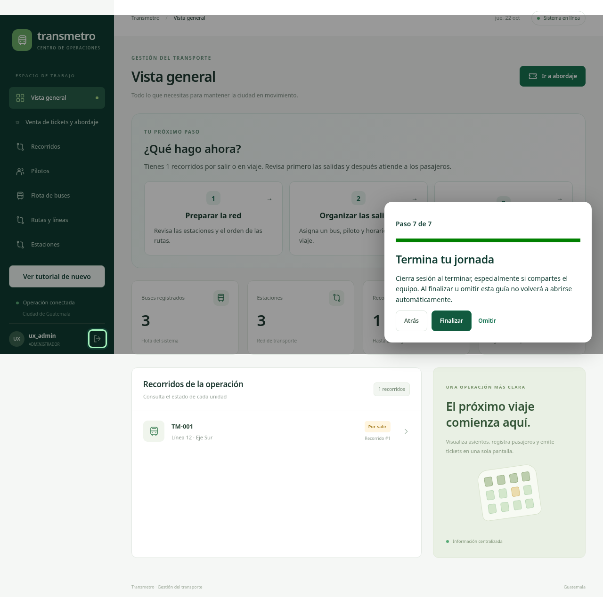
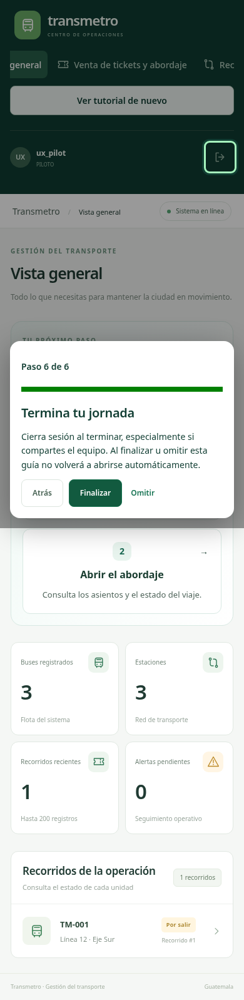
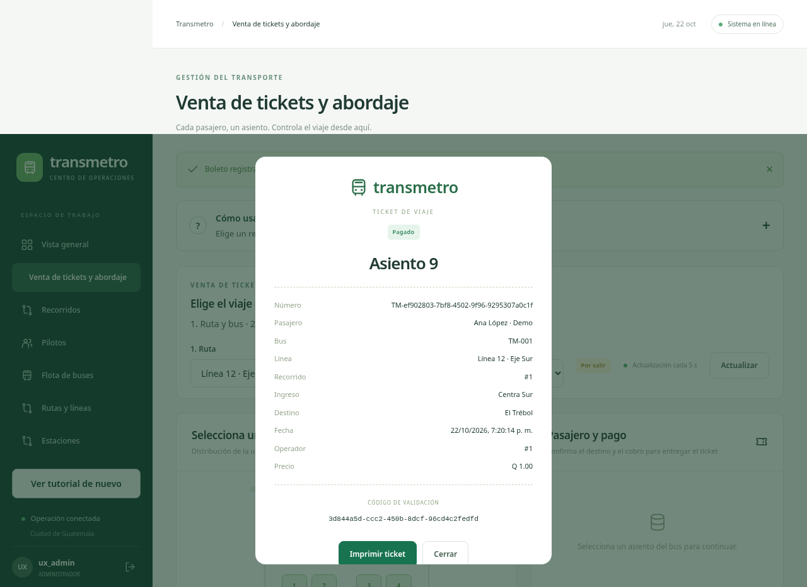

# Validación UX — 22 de octubre de 2026

Entorno aislado: MariaDB 10.11 en 127.0.0.1:33329, bases transmetro_ux_test, transmetro_ui_test y transmetro_migration_test. API del navegador en 3149 y Vite en 5199. Cuentas y contraseñas generadas exclusivamente para pruebas. No se utilizó la contraseña compartida por el usuario ni la base de Railway.

| Comprobación | Resultado |
| --- | --- |
| Compilación backend y frontend | Aprobada |
| Suite backend | 28 entradas TAP aprobadas, 0 fallos, 0 omitidas; incluye el contenedor de integración: 27 comprobaciones independientes |
| Tutorial de administrador, supervisor, operador, financiero, seguridad y piloto | 6 escenarios aprobados; 6 pasos, 7 en administrador |
| Omitir, nueva sesión/dispositivo simulado, foco de teclado | Aprobado |
| Venta con destino posterior, tarjeta condicional y boleto | Aprobado con base real local |
| Fallo de red al guardar tutorial y cierre con respaldo | Aprobado mediante interrupción controlada de esa solicitud |
| Navegación de todas las opciones visibles para seis roles | Aprobada sin alertas de error de carga |
| Total navegador | 10 escenarios aprobados (9 + 1 navegación) |
| Escritorio y celular | Chromium 1280×720 y 390×844; sin desbordamiento horizontal en las comprobaciones; salida visible |
| Consola JavaScript | Sin excepciones pageerror en los seis recorridos guiados; 401 inicial sin sesión y aborto de red son casos esperados |
| Migración en usuario preexistente | Valor false comprobado; ALTER inverso conserva el usuario |
| Auditoría npm frontend | 0 vulnerabilidades tras actualizar Vite 7.3.7 y dependencia transitiva source-map-js |

Las pruebas de navegador se ejecutan en dos lotes con servidores nuevos para respetar el límite real de diez inicios de sesión por minuto. No se debilitó ese límite. El preparador conserva datos; repetir ventas usa el primer asiento y pasajero disponibles. Si se agotan, crear otra base de prueba vacía.

## Hallazgos corregidos durante la verificación
- Menú de escritorio desbordado: zona de navegación desplazable, ayuda y perfil accesibles.
- Foco del tutorial: el resaltado ya no roba el foco cuando la persona está usando sus controles.
- Consultas reiteradas de catálogos: carga por pantalla, evitando alcanzar el límite durante la navegación normal.
- Pasajero con boleto activo: ya no aparece como opción para comprar otro asiento en el mismo viaje. El backend conserva su validación contra duplicados.
- Catálogo de operadores: el selector de cuentas usa el endpoint de usuarios, exclusivo del administrador.

## Evidencia visual

## Límites de lo probado
No se publicó ni se probó el entorno productivo. No se verificaron Safari, Firefox, lectores de pantalla, impresoras físicas, todos los tamaños de tableta ni cada combinación de múltiples roles. La navegación por rol no equivale a ejecutar todas las mutaciones de cada pantalla; la suite backend cubre venta, reservas, cobros, reembolsos, asignaciones, horarios, aforo y permisos. No se realizó una carga sostenida ni una evaluación de usabilidad con personas. Las capturas muestran exclusivamente datos ficticios.

Siguiente mejora recomendada: pruebas con usuarios reales, paginación de reportes y separación gradual de las pantallas concentradas en main.tsx, conservando sus funciones.
